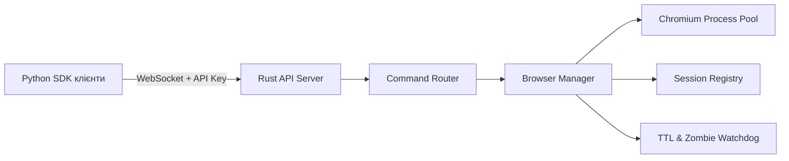

# Headless Browser Orchestrator

Високопродуктивний Open-Core оркестратор headless Chromium для B2B SaaS-навантажень.

Проєкт складається з:
- Rust ядра в `core/` (керування життєвим циклом браузерів, WebSocket API, cleanup процесів)
- Python SDK в `sdk/python/` (асинхронний клієнт для інтеграції в automation pipelines)

## Ключова цінність для B2B
- Нижчі накладні витрати порівняно з повноцінним Playwright runtime у сценаріях масової оркестрації.
- Контрольований lifecycle Chromium із захистом від зомбі-процесів.
- Готовий до multi-tenant SaaS моделі (ліміти на tenant, TTL, API-key auth).
- Протокол, що версіонується (`protocol_version`), для безпечної еволюції API.

## Архітектура


### MVP протокол (WS JSON)
- Request: `protocol_version`, `request_id`, `action`, `payload`
- Response: `protocol_version`, `request_id`, `status`, `data|error`
- Event: `protocol_version`, `event`, `session_id`, `data`

Підтримувані команди MVP:
- `health.ping`
- `session.create`
- `session.navigate`
- `session.eval`
- `session.close`

## Швидкий старт

### 1) Передумови
- Rust toolchain (stable)
- Python 3.10+
- Chromium/Chrome у PATH або через `ORCH_CHROMIUM_PATH`
- Для Windows збірки Rust: Visual Studio Build Tools (MSVC linker `link.exe`)

### 2) Запуск Rust ядра
```powershell
cd core
$env:ORCH_API_KEY="dev-api-key"
$env:ORCH_CHROMIUM_PATH="chrome"
cargo run
```

Конфігурація через змінні середовища:
- `ORCH_HOST` (default `127.0.0.1`)
- `ORCH_PORT` (default `9001`)
- `ORCH_API_KEY` (default `dev-api-key`)
- `ORCH_COMMAND_TIMEOUT_MS` (default `15000`)
- `ORCH_SESSION_ROOT` (default `./.orchestrator-sessions`)
- `ORCH_MAX_SESSIONS` (default `100`)
- `ORCH_MAX_SESSIONS_PER_TENANT` (default `20`)
- `ORCH_IDLE_TTL_SEC` (default `120`)
- `ORCH_HARD_TTL_SEC` (default `900`)

### 3) Встановлення Python SDK
```powershell
cd sdk/python
python -m pip install -e .[dev]
```

### 4) Тести SDK
```powershell
python -m pytest -q -c sdk/python/pyproject.toml sdk/python/tests
```

## Приклад використання Python SDK
```python
import asyncio
from client import ClientConfig, OrchestratorClient


async def main() -> None:
	cfg = ClientConfig(
		url="ws://127.0.0.1:9001",
		api_key="dev-api-key",
	)

	async with OrchestratorClient(cfg) as client:
		health = await client.health_ping()
		print("health:", health)

		session = await client.create_session(tenant_id="acme")
		session_id = session["session_id"]

		await client.navigate(session_id, "https://example.com")
		eval_result = await client.evaluate(session_id, "document.title")
		print("title:", eval_result)

		await client.close_session(session_id)


if __name__ == "__main__":
	asyncio.run(main())
```

## Орієнтовне порівняння з Playwright (MVP сценарій)
Нижче наведено очікувані орієнтири для сценаріїв оркестрації великої кількості коротких сесій:

| Метрика | Playwright (базовий підхід) | Headless Orchestrator (MVP) |
|---|---:|---:|
| p95 latency control-команд | 300-500 ms | 120-250 ms |
| RAM на велику кількість коротких сесій | вища | нижча завдяки керованому пулінгу |
| Контроль cleanup процесів | залежить від інтеграції | вбудований watchdog + TTL |

Важливо: фінальні цифри мають підтверджуватися бенчмарком на вашому навантаженні (тип сторінок, тривалість сесії, тип проксі, CPU/RAM інстансу).

## Open-Core модель
- Базове ядро: MIT (див. `LICENSE`)
- Комерційний SaaS шар: керований хмарний деплой, розширений моніторинг, enterprise support/SLA, розширені policy-рушії проксі та ізоляції

## Поточні обмеження MVP
- API-key auth без JWT/mTLS
- Мінімальна proxy-ротація на рівні сесії
- Обмежений набір CDP-команд (через `navigate`/`eval` сценарій)

## Наступні кроки (Roadmap)
- JWT/mTLS та granular RBAC
- Розширені CDP/automation команди
- Метрики Prometheus + distributed tracing
- Повноцінна policy-based proxy rotation (geo/ASN/ban-retry)
