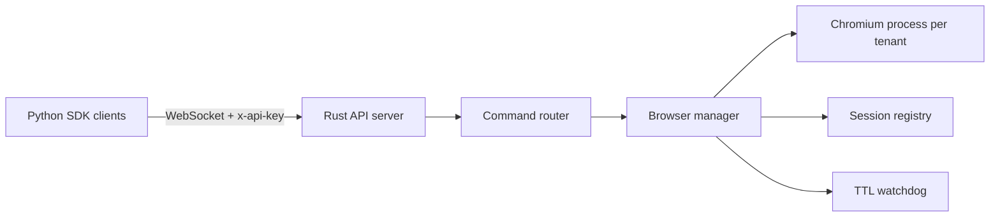

# Headless Browser Orchestrator

A high-performance, open-core orchestrator for headless Chromium, built for multi-tenant (B2B SaaS) workloads.

It lets you start, control and safely tear down many isolated browser sessions through a single WebSocket API, so your scraping, testing or automation pipelines do not have to manage Chromium processes themselves.

## Table of contents

1. [What is this project for?](#what-is-this-project-for)
2. [How it works](#how-it-works)
3. [Repository layout](#repository-layout)
4. [Download](#download)
5. [Requirements](#requirements)
6. [Run the Rust core](#run-the-rust-core)
7. [Install and use the Python SDK](#install-and-use-the-python-sdk)
8. [Configuration reference](#configuration-reference)
9. [WebSocket protocol](#websocket-protocol)
10. [Run the tests](#run-the-tests)
11. [Security notes](#security-notes)
12. [Performance expectations](#performance-expectations)
13. [Current limitations](#current-limitations)
14. [Roadmap](#roadmap)
15. [License](#license)

## What is this project for?

Running headless Chrome at scale is hard. You have to launch processes, keep sessions isolated from each other, enforce limits per customer, and make sure no Chromium process is left running after a crash, a timeout or a restart.

This project solves that with two parts:

- **Rust core (`core/`)** – a long-running service that launches Chromium, talks to it over the Chrome DevTools Protocol (CDP), enforces limits and TTLs, and cleans everything up.
- **Python SDK (`sdk/python/`)** – an async client that connects to the service so you can drive browsers from your own Python code.

Typical use cases:

- Large-scale web scraping and data extraction
- Automated end-to-end testing and monitoring
- Screenshot / rendering services
- Any SaaS product that needs to give many customers (tenants) their own isolated browsers

Main benefits:

- **Controlled lifecycle** – every Chromium child process is tracked; sessions expire automatically and the process is killed on shutdown.
- **Tenant isolation** – each tenant gets its own Chromium process and its own profile directory; each session runs in a separate browser context.
- **Resource limits** – global and per-tenant session caps, idle TTL and hard TTL.
- **Simple API** – a small JSON-over-WebSocket protocol with an explicit `protocol_version`.
- **Authentication** – API-key check during the WebSocket handshake.

## How it works



Key ideas:

- **One Chromium process per tenant.** The first session for a tenant launches Chromium with its own `--user-data-dir` under `ORCH_SESSION_ROOT/<tenant_id>`.
- **One browser context per session.** Sessions of the same tenant share the process but are isolated from each other (cookies, storage, cache).
- **Watchdog.** A background task runs every 5 seconds and closes sessions that exceeded the idle TTL or the hard TTL.
- **Graceful shutdown.** On Ctrl+C the service closes all sessions, kills the Chromium processes, waits for them to exit (with a timeout) and deletes the tenant profile directories.
- **Timeouts.** Every command is limited by `ORCH_COMMAND_TIMEOUT_MS`; Chromium start-up is limited by `ORCH_LAUNCH_TIMEOUT_MS`.

## Repository layout

```
.
├── core/                  Rust service (tokio, tokio-tungstenite, CDP)
│   ├── Cargo.toml
│   └── src/
│       ├── main.rs        Entry point, configuration, shutdown handling
│       ├── api.rs         WebSocket server, auth, protocol, command routing
│       └── browser.rs     Chromium lifecycle, sessions, TTL watchdog
├── sdk/python/            Async Python client (websockets)
│   ├── pyproject.toml
│   ├── client.py
│   └── tests/
├── README.md
└── LICENSE
```

## Download

### Option 1: clone with Git (recommended)

```bash
git clone https://github.com/<your-username>/<your-repository>.git
cd <your-repository>
```

Replace `<your-username>/<your-repository>` with the real address of this repository.

### Option 2: download a ZIP archive

1. Open the repository page on GitHub.
2. Click the green **Code** button.
3. Choose **Download ZIP**.
4. Unpack the archive and open a terminal in the unpacked folder.

## Requirements

| Component | Requirement |
|---|---|
| Rust | Stable toolchain, installed with [rustup](https://rustup.rs). The crate uses Rust edition 2024, so use Rust 1.85 or newer. |
| Python | 3.10 or newer (only for the SDK) |
| Browser | Chromium, Google Chrome or Microsoft Edge |
| Windows only | Visual Studio Build Tools with the MSVC linker (`link.exe`) |
| Linux only | A C toolchain, for example `sudo apt install build-essential` |

If the browser is not on your `PATH`, set `ORCH_CHROMIUM_PATH` to its full path. On Windows the service also looks for Chrome and Edge in the standard install folders.

## Run the Rust core

### Windows (PowerShell)

```powershell
cd core
$env:ORCH_API_KEY = "change-me"
$env:ORCH_CHROMIUM_PATH = "chrome"
cargo run --release
```

### Linux / macOS

```bash
cd core
export ORCH_API_KEY="change-me"
export ORCH_CHROMIUM_PATH="chromium"   # or google-chrome, or a full path
cargo run --release
```

When the service is ready you will see a log line like `ws api started` with the address `127.0.0.1:9001`.

Stop it with **Ctrl+C**. The service will close all sessions and terminate every Chromium process it started.

## Install and use the Python SDK

Install in editable mode with the development dependencies:

```bash
cd sdk/python
python -m pip install -e ".[dev]"
```

Minimal example (make sure the Rust core is running and the API key matches):

```python
import asyncio

from client import ClientConfig, OrchestratorClient


async def main() -> None:
    cfg = ClientConfig(url="ws://127.0.0.1:9001", api_key="change-me")

    async with OrchestratorClient(cfg) as client:
        print("health:", await client.health_ping())

        session = await client.create_session(tenant_id="acme")
        session_id = session["session_id"]

        await client.navigate(session_id, "https://example.com")
        title = await client.evaluate(session_id, "document.title")
        print("title:", title)

        await client.close_session(session_id)


if __name__ == "__main__":
    asyncio.run(main())
```

Always call `close_session` when you are done. If you forget, the watchdog will close the session after the idle or hard TTL.

Errors raised by the SDK:

- `ProtocolError` – the server response is malformed, or its `request_id` does not match the request.
- `CommandError` – the server returned `status: "error"` for your command (for example `ValidationError`, `TimeoutError`, `InternalError`).

## Configuration reference

All settings are environment variables read by the Rust core.

| Variable | Default | Description |
|---|---|---|
| `ORCH_HOST` | `127.0.0.1` | Address the WebSocket server binds to |
| `ORCH_PORT` | `9001` | Port of the WebSocket server |
| `ORCH_API_KEY` | `dev-api-key` | Expected value of the `x-api-key` header. **Always change this outside local development.** |
| `ORCH_COMMAND_TIMEOUT_MS` | `15000` | Maximum time for one command |
| `ORCH_CHROMIUM_PATH` | auto-detected, else `chrome` | Path to the Chromium / Chrome / Edge executable |
| `ORCH_SESSION_ROOT` | `./.orchestrator-sessions` | Directory for per-tenant browser profiles |
| `ORCH_LAUNCH_TIMEOUT_MS` | `15000` | Maximum time to wait for Chromium to expose its DevTools endpoint |
| `ORCH_GRACEFUL_SHUTDOWN_TIMEOUT_MS` | `5000` | Maximum time to wait for Chromium to exit after the kill signal |
| `ORCH_MAX_SESSIONS` | `100` | Global session limit |
| `ORCH_MAX_SESSIONS_PER_TENANT` | `20` | Session limit per tenant |
| `ORCH_IDLE_TTL_SEC` | `120` | Close a session after this many seconds without use |
| `ORCH_HARD_TTL_SEC` | `900` | Close a session this many seconds after creation, no matter what |

## WebSocket protocol

Connect to `ws://<host>:<port>` and send the header `x-api-key: <your key>`. Without a valid key the handshake is rejected with HTTP 401.

All messages are JSON text frames. The current `protocol_version` is `"1.0"`.

**Request**

```json
{
  "protocol_version": "1.0",
  "request_id": "any-unique-string",
  "action": "session.navigate",
  "payload": { "session_id": "...", "url": "https://example.com" }
}
```

**Response**

```json
{
  "protocol_version": "1.0",
  "request_id": "any-unique-string",
  "status": "ok",
  "data": { "session_id": "...", "url": "https://example.com", "target_id": "..." }
}
```

On failure `status` is `"error"` and an `error` object with `code` and `message` is returned instead of `data`. Error codes: `ValidationError`, `TimeoutError`, `InternalError`.

**Event** (sent after `session.create` and `session.close`)

```json
{
  "protocol_version": "1.0",
  "event": "session.created",
  "session_id": "...",
  "data": { "tenant_id": "acme" }
}
```

### Supported actions

| Action | Payload | Result |
|---|---|---|
| `health.ping` | none | `{ "status": "pong", "active_sessions": <number> }` |
| `session.create` | `tenant_id` (optional, default `"default"`), `proxy` (optional, for example `http://host:port`) | Session snapshot with `session_id`, `tenant_id`, `ws_endpoint`, `browser_context_id`, `user_data_dir`, timestamps |
| `session.navigate` | `session_id`, `url` | `session_id`, `url`, `target_id` |
| `session.eval` | `session_id`, `expression` (JavaScript) | `session_id`, `result` |
| `session.close` | `session_id` | `session_id`, `closed` (boolean) |

## Run the tests

From the repository root:

```bash
python -m pytest -q -c sdk/python/pyproject.toml sdk/python/tests
```

The SDK tests use a fake WebSocket server, so they do not need Chromium or the Rust core.

## Security notes

- Change `ORCH_API_KEY` before exposing the service to any network.
- The default bind address is `127.0.0.1`. If you set `ORCH_HOST=0.0.0.0`, put the service behind a TLS-terminating reverse proxy (nginx, Caddy, a cloud load balancer), because the server itself speaks plain `ws://`.
- `session.eval` executes arbitrary JavaScript in the browser. Only give API keys to clients you trust.

## Performance expectations

The numbers below are rough design targets for orchestrating many short sessions, **not measured results**. Run your own benchmark with your real pages, session lengths, proxies and instance size.

| Metric | Playwright (typical setup) | Headless Orchestrator (MVP target) |
|---|---:|---:|
| p95 control-command latency | 300–500 ms | 120–250 ms |
| RAM for many short sessions | higher | lower, due to shared per-tenant browsers |
| Process cleanup | depends on your integration | built-in watchdog and TTLs |

## Current limitations

- Authentication is a single shared API key (no JWT, mTLS or per-user roles).
- The proxy is applied when a tenant's Chromium process is launched, so it applies to all sessions of that tenant until the process is restarted.
- Only a small set of commands is exposed (`navigate` and `eval`); there is no screenshot, click or typing command yet.
- Graceful cleanup is triggered by Ctrl+C. Forced termination of the service itself (for example `kill -9`) cannot run cleanup code.

## Roadmap

- JWT / mTLS authentication and granular RBAC
- More CDP and automation commands (screenshots, input, cookies)
- Prometheus metrics and distributed tracing
- Policy-based proxy rotation (geo, ASN, ban-and-retry)

## License

The open core is released under the MIT License (see `LICENSE`).

The commercial SaaS layer is separate and may include managed cloud hosting, advanced monitoring, enterprise support with SLA, and advanced proxy and isolation policy engines.
